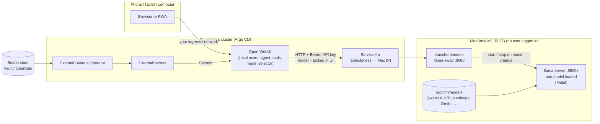

# Private AI service: MacBook M1 (32 GB) model server + agent UI on Kubernetes

Goal, starting from a **freshly set up MacBook M1 with 32 GB RAM**:

1. The Mac serves **several LLMs** (default **Qwen3.8-27B**) as a **system service**
   that starts at boot **with nobody logged in**, listens on the network and requires an
   **API key**. **llama-swap** keeps **one model in memory at a time** and loads whichever
   one is requested.
2. A **Kubernetes cluster** managed by **Argo CD** (Kustomize `kustomization.yaml`
   rendering **Helm charts**) runs **Open WebUI**, a chat and agent front end with tools,
   web search, knowledge bases and MCP. It has **local users managed by an admin**,
   gets its credentials from **External Secrets**, and lets you **pick the model from the
   model selector**.
3. You use it from your **phone, tablet and computer** through the browser. How the
   Open WebUI Service is exposed (ingress, VPN, DNS, certificates) is **out of scope**:
   plug in your existing networking.

**Annex A** lists the latest models that fit, including uncensored and abliterated
variants (checked 2026-11-06). The main path (sections 1–3) is the shortest route that
works. Choices, alternatives and parameters are in the **annexes** at the end. Every step
ends with a ✅ check.

*Based on the model and tool versions in `hugging-models.md` (checked 2026-10-18). Chart
versions are deliberately left as placeholders: look them up and pin them (step 2.2).
I have not run these exact manifests against your cluster, so run each ✅ check before
moving on.*

---

## 0. Overview



How a model switch works: Open WebUI lists the models from `GET /v1/models`, which
llama-swap answers from its config without loading anything. When you send a message
with a different model selected, llama-swap stops the running `llama-server`, starts the
one for that model, waits until it is healthy, and forwards the request. The first reply
after a switch waits for the load, about 20–60 s for a 16–19 GB model. Later replies are
immediate.

### Placeholders

| Placeholder | Meaning | Example |
|---|---|---|
| `<MAC_IP>` | Fixed LAN IP of the Mac (DHCP reservation) | `192.168.1.50` |
| `<MAC_NAME>` | Local host name of the Mac | `modelmac` |
| `<GIT_REPO>` | Git repo Argo CD reads | `https://github.com/ORG/homelab-gitops.git` |
| `<VAULT_ADDR>` | Address of Vault/OpenBao | `https://vault.lan:8200` |
| `<WEBUI_URL>` | URL your devices use for Open WebUI (your networking) | `https://ai.example.lan` |
| `<…_CHART_VERSION>` | Pinned Helm chart versions | from step 2.2 |

The **LLM API key** is generated once (step 1.4). It is copied to the Mac and stored in
the secret store, and the cluster reads it from the store. There is no second copy in Git.

---

## 1. The Mac: model server as a boot-time service

### 1.1 First boot and base settings

During Setup Assistant create one **admin** account (e.g. `admin`). Then, logged in
as that admin, open Terminal:

```bash
# Name the machine (used for <MAC_NAME>.local and in logs)
sudo scutil --set ComputerName  modelmac
sudo scutil --set LocalHostName modelmac
sudo scutil --set HostName      modelmac

# Remote management: SSH (see macos-openssh.md for key-only hardening)
sudo systemsetup -setremotelogin on

# Never sleep, survive lid closed and power loss
sudo pmset -a sleep 0 disksleep 0 displaysleep 10 powernap 0 standby 0 autorestart 1 womp 1
sudo pmset -a disablesleep 1

# No surprise reboots from automatic macOS upgrades (security data still installs)
sudo defaults write /Library/Preferences/com.apple.SoftwareUpdate AutomaticallyInstallMacOSUpdates -bool false
```

**Unattended reboot.** With **FileVault** on, a rebooted Mac waits at the unlock
screen, and no daemon starts until someone unlocks it. For a server that must come back
on its own, turn FileVault off (System Settings → Privacy & Security → FileVault). To keep
it on, see **Annex C**.

Network: use **Ethernet** (USB-C adapter) if you can, and give the Mac a **DHCP
reservation** (`<MAC_IP>`) in your router. Saved Wi-Fi networks also join at boot, before
login.

✅ Check:

```bash
scutil --get LocalHostName                 # modelmac
sudo systemsetup -getremotelogin           # Remote Login: On
pmset -g | grep -E ' sleep|disablesleep|autorestart'   # sleep 0, disablesleep 1, autorestart 1
fdesetup status                            # "FileVault is Off." (or see Annex C)
ipconfig getifaddr en0; ipconfig getifaddr en1   # one of these is <MAC_IP>
ssh admin@modelmac.local 'echo ok'         # from another computer
```

### 1.2 Install the tools

```bash
xcode-select --install          # wait for the GUI installer to finish
/bin/bash -c "$(curl -fsSL https://raw.githubusercontent.com/Homebrew/install/HEAD/install.sh)"
echo 'eval "$(/opt/homebrew/bin/brew shellenv)"' >> ~/.zprofile
eval "$(/opt/homebrew/bin/brew shellenv)"

brew install llama.cpp huggingface-cli
brew tap mostlygeek/llama-swap && brew install llama-swap
```

If the tap is unavailable, download `llama-swap_*_darwin_arm64.tar.gz` from
https://github.com/mostlygeek/llama-swap/releases and put the binary in
`/opt/homebrew/bin/` (`xattr -d com.apple.quarantine` it).

✅ Check (Qwen3.8 needs a recent llama.cpp; run `brew upgrade llama.cpp` if in doubt):

```bash
which llama-server                         # /opt/homebrew/bin/llama-server
llama-server --version
llama-server --help | grep -E -- '--api-key-file|--metrics'   # both must exist
hf version
which llama-swap && llama-swap --version     # /opt/homebrew/bin/llama-swap
```

### 1.3 Service account and directories

The daemon runs as a dedicated hidden account `_llm`, without admin rights, a login
shell or a GUI session.

```bash
# pick a free UID in the role-account range (200–400)
dscl . -list /Users UniqueID | awk '$2==399'      # must print nothing

sudo sysadminctl -addUser _llm -fullName "LLM service" -UID 399 \
  -roleAccount -shell /usr/bin/false -home /opt/llm

sudo mkdir -p /opt/llm/{models,etc,cache} /Library/Logs/llm
sudo chown -R _llm /opt/llm /Library/Logs/llm
sudo chmod 750 /opt/llm/etc
```

✅ Check:

```bash
id _llm                         # uid=399(_llm) ...
dscl . -read /Users/_llm UserShell NFSHomeDirectory   # /usr/bin/false, /opt/llm
ls -ld /opt/llm /opt/llm/etc /Library/Logs/llm
```

### 1.4 API key (the credential)

Generate it **once** on your admin workstation and keep it in your clipboard or password
manager for step 2.4:

```bash
openssl rand -hex 32            # → <API_KEY>
```

Install it on the Mac as a file that only the service user can read:

```bash
sudo sh -c 'umask 077; read -rs -p "API key: " k; echo; printf "%s\n" "$k" > /opt/llm/etc/api-key'
sudo chown _llm /opt/llm/etc/api-key
sudo chmod 400 /opt/llm/etc/api-key
```

✅ Check (compare the fingerprint with the one from your workstation:
`printf '%s' '<API_KEY>' | shasum -a 256`):

```bash
sudo ls -l /opt/llm/etc/api-key            # -r-------- _llm
sudo head -1 /opt/llm/etc/api-key | tr -d '\n' | shasum -a 256
```

### 1.5 Download the models

Start with two models: one smart and one fast. You choose between them per chat in
Open WebUI, and Annex A adds more (Nanbeige, Ornith, uncensored builds). They are stored
on disk only; llama-swap loads one at a time.

| Model id (shown in the UI) | File | Size | Use |
|---|---|---|---|
| `qwen3.8-27b` / `qwen3.8-27b-think` | `unsloth/Qwen3.8-27B-GGUF` `UD-Q4_K_M` | 16.5 GB | most accurate that fits (≈ 8–12 tok/s M1 Pro); the second id is the same file with reasoning on |
| `qwen3.5-9b` | `unsloth/Qwen3.5-9B-GGUF` `Q8_0` | 9.5 GB | 2–3× faster, quick questions |

```bash
dl() { sudo -u _llm env HF_HOME=/opt/llm/cache /opt/homebrew/bin/hf download "$1" \
         --include "*$2*" --local-dir "/opt/llm/models/$3"; }
dl unsloth/Qwen3.8-27B-GGUF UD-Q4_K_M qwen3.8-27b
dl unsloth/Qwen3.5-9B-GGUF  Q8_0      qwen3.5-9b

MODEL=$(ls /opt/llm/models/qwen3.8-27b/*UD-Q4_K_M*.gguf | head -1); echo "$MODEL"
```

If a quant is split into several files (`-00001-of-0000N.gguf`), point at the first one;
llama.cpp loads the rest itself.

✅ Check:

```bash
du -sh /opt/llm/models/*                   # ≈ 16.5 GB and ≈ 9.5 GB
df -h /                                    # keep ≥ 20 GB free
```

### 1.6 Give the GPU enough memory

macOS lets the GPU wire only about ⅔ of RAM (~21 GB) by default. Raise it to 26 GB and
make the setting survive reboots:

```bash
sudo tee /Library/LaunchDaemons/com.local.iogpu-wired-limit.plist >/dev/null <<'EOF'
<?xml version="1.0" encoding="UTF-8"?>
<!DOCTYPE plist PUBLIC "-//Apple//DTD PLIST 1.0//EN" "http://www.apple.com/DTDs/PropertyList-1.0.dtd">
<plist version="1.0">
<dict>
  <key>Label</key><string>com.local.iogpu-wired-limit</string>
  <key>ProgramArguments</key>
  <array><string>/usr/sbin/sysctl</string><string>iogpu.wired_limit_mb=26624</string></array>
  <key>RunAtLoad</key><true/>
</dict>
</plist>
EOF
sudo chown root:wheel /Library/LaunchDaemons/com.local.iogpu-wired-limit.plist
sudo launchctl bootstrap system /Library/LaunchDaemons/com.local.iogpu-wired-limit.plist
```

✅ Check: `sysctl iogpu.wired_limit_mb` → `26624`.

### 1.7 Test one model in the foreground

Before adding llama-swap, check that one model runs on the GPU as `_llm`:

```bash
sudo -u _llm /opt/homebrew/bin/llama-server \
  -m "$MODEL" --alias qwen3.8-27b \
  --host 0.0.0.0 --port 8080 --api-key-file /opt/llm/etc/api-key \
  --jinja -ngl 99 -c 65536 -fa on -ctk q8_0 -ctv q8_0 \
  --temp 0.7 --top-p 0.8 --top-k 20 --presence-penalty 1.5 \
  --chat-template-kwargs '{"enable_thinking":false}' \
  --metrics
```

Each flag is explained in **Annex B**. In short: all layers on the Metal GPU, 64k
context with a q8 KV cache (≈ 22 GB total), tool-calling chat template, thinking off (the
fast default; Annex A shows how to switch it on).

In the startup log, look for a Metal device line (`ggml_metal` / `MTL`), `offloaded
65/65 layers to GPU` (or N/N), and `server is listening on http://0.0.0.0:8080`.

✅ Check, from a second terminal on the Mac:

```bash
K=$(sudo cat /opt/llm/etc/api-key)
curl -s localhost:8080/health                                       # {"status":"ok"}
curl -s -o /dev/null -w '%{http_code}\n' localhost:8080/v1/models   # 401 (no key: refused)
curl -s localhost:8080/v1/models -H "Authorization: Bearer $K"      # lists qwen3.8-27b
curl -s localhost:8080/v1/chat/completions -H "Authorization: Bearer $K" \
  -H 'Content-Type: application/json' \
  -d '{"model":"qwen3.8-27b","messages":[{"role":"user","content":"Say hello in 3 languages."}]}' \
  | python3 -c 'import sys,json; r=json.load(sys.stdin); print(r["choices"][0]["message"]["content"]); print(r.get("timings"))'
```

`timings.predicted_per_second` is the generation speed. Expect roughly 8–12 tok/s on an
M1 Pro and more on an M1 Max. Stop the server with `Ctrl+C`.

### 1.8 llama-swap: one model at a time, chosen by the client

`llama-swap` listens on port 8080 and exposes one OpenAI-compatible API for all models.
For each request it reads the `model` field. If that model isn't the one currently
loaded, it stops the running `llama-server` and starts the right one on a localhost
port. With no `groups` configured, **only one model runs at a time**, which is what you
want with a single user and 32 GB.

Write the config. Paths are resolved now, so the file has no globs:

```bash
Q27=$(ls /opt/llm/models/qwen3.8-27b/*UD-Q4_K_M*.gguf | head -1)
Q9=$(ls /opt/llm/models/qwen3.5-9b/*Q8_0*.gguf | head -1)
sudo tee /opt/llm/etc/llama-swap.yaml >/dev/null <<EOF
# llama-swap: one llama-server at a time, started on demand
healthCheckTimeout: 600        # seconds to wait for a model to load
logLevel: info
startPort: 5801                # backends get 5801, 5802, … on 127.0.0.1

macros:
  server: >-
    /opt/homebrew/bin/llama-server --host 127.0.0.1 --port \${PORT}
    --api-key-file /opt/llm/etc/api-key
    --jinja -ngl 99 -fa on --metrics
  qwen-fast: >-
    --temp 0.7 --top-p 0.8 --top-k 20 --presence-penalty 1.5
    --chat-template-kwargs '{"enable_thinking":false}'
  qwen-think: >-
    --temp 1.0 --top-p 0.95 --top-k 20 --min-p 0

models:
  qwen3.8-27b:
    name: "Qwen3.8 27B (accurate)"
    cmd: \${server} -m $Q27 -c 65536 -ctk q8_0 -ctv q8_0 \${qwen-fast}
  qwen3.8-27b-think:
    name: "Qwen3.8 27B (reasoning, slow)"
    cmd: \${server} -m $Q27 -c 65536 -ctk q8_0 -ctv q8_0 \${qwen-think}
  qwen3.5-9b:
    name: "Qwen3.5 9B (fast)"
    cmd: \${server} -m $Q9 -c 65536 -ctk q8_0 -ctv q8_0 \${qwen-fast}
EOF
sudo chown _llm /opt/llm/etc/llama-swap.yaml
sudo grep -E '^\s+cmd:' /opt/llm/etc/llama-swap.yaml     # real paths, ${server}/${qwen-…} kept literally
```

Notes:

- `${PORT}` and the macros are expanded by llama-swap, not by the shell.
  `ttl` isn't set, so a model stays loaded until another one is requested. Add `ttl: 1800`
  under a model to unload it after 30 min idle and free the RAM.
- **Authentication:** every backend `llama-server` checks the API key (`--api-key-file`)
  and llama-swap passes the `Authorization` header through, so chat and completion
  requests need the key. llama-swap's own endpoints (`/v1/models` list, `/running`,
  `/unload`, `/ui`, `/logs`) **are not protected**. Restrict access with your network, or see
  Annex D.

Foreground test as `_llm`:

```bash
sudo -u _llm /opt/homebrew/bin/llama-swap --config /opt/llm/etc/llama-swap.yaml --listen 0.0.0.0:8080
```

✅ Check, from a second terminal (watch the first terminal for the backend starting):

```bash
K=$(sudo cat /opt/llm/etc/api-key)
curl -s localhost:8080/v1/models | python3 -m json.tool | grep '"id"'   # the 3 ids, nothing loaded yet
curl -s localhost:8080/running                                          # empty
ask() { curl -s localhost:8080/v1/chat/completions -H "Authorization: Bearer $K" \
  -H 'Content-Type: application/json' \
  -d "{\"model\":\"$1\",\"messages\":[{\"role\":\"user\",\"content\":\"Which model are you? One line.\"}]}" \
  | python3 -c 'import sys,json; r=json.load(sys.stdin); print(r["choices"][0]["message"]["content"][:200]); print(r.get("timings",{}).get("predicted_per_second"))'; }
time ask qwen3.5-9b       # first call loads the 9B
curl -s localhost:8080/running                                          # qwen3.5-9b
time ask qwen3.8-27b      # 9B stopped, 27B loaded (20–60 s), then answers
curl -s localhost:8080/running                                          # only qwen3.8-27b
pgrep -fl llama-server                                                  # exactly ONE process
curl -s -o /dev/null -w '%{http_code}\n' localhost:8080/v1/chat/completions \
  -H 'Content-Type: application/json' -d '{"model":"qwen3.8-27b","messages":[]}'   # 401 without key
```

Stop it with `Ctrl+C`; the backend stops with it.

### 1.9 Install llama-swap as a LaunchDaemon (runs with nobody logged in)

A **LaunchDaemon** in `/Library/LaunchDaemons` runs in the system domain at boot. A
LaunchAgent, by contrast, needs a login. `UserName` drops privileges to `_llm`, and the
`llama-server` processes started by llama-swap inherit that account.

```bash
sudo tee /Library/LaunchDaemons/com.local.llama-swap.plist >/dev/null <<'EOF'
<?xml version="1.0" encoding="UTF-8"?>
<!DOCTYPE plist PUBLIC "-//Apple//DTD PLIST 1.0//EN" "http://www.apple.com/DTDs/PropertyList-1.0.dtd">
<plist version="1.0">
<dict>
  <key>Label</key><string>com.local.llama-swap</string>
  <key>UserName</key><string>_llm</string>
  <key>WorkingDirectory</key><string>/opt/llm</string>
  <key>EnvironmentVariables</key>
  <dict>
    <key>HOME</key><string>/opt/llm</string>
    <key>PATH</key><string>/opt/homebrew/bin:/usr/bin:/bin</string>
  </dict>
  <key>ProgramArguments</key>
  <array>
    <string>/opt/homebrew/bin/llama-swap</string>
    <string>--config</string><string>/opt/llm/etc/llama-swap.yaml</string>
    <string>--listen</string><string>0.0.0.0:8080</string>
    <string>--watch-config</string>
  </array>
  <key>RunAtLoad</key><true/>
  <key>KeepAlive</key><true/>
  <key>ThrottleInterval</key><integer>30</integer>
  <key>ProcessType</key><string>Interactive</string>
  <key>StandardOutPath</key><string>/Library/Logs/llm/server.log</string>
  <key>StandardErrorPath</key><string>/Library/Logs/llm/server.err.log</string>
</dict>
</plist>
EOF
sudo chown root:wheel /Library/LaunchDaemons/com.local.llama-swap.plist
sudo chmod 644 /Library/LaunchDaemons/com.local.llama-swap.plist
plutil -lint /Library/LaunchDaemons/com.local.llama-swap.plist
sudo launchctl bootstrap system /Library/LaunchDaemons/com.local.llama-swap.plist
```

Nothing secret is in the plist or the YAML; the key stays in `/opt/llm/etc/api-key`.
`--watch-config` reloads the YAML when you add a model, so no restart is needed.
`ProcessType Interactive` stops macOS from throttling the daemon as background work.

Manage it:

```bash
sudo launchctl kickstart -k system/com.local.llama-swap   # restart
sudo launchctl bootout system/com.local.llama-swap        # stop + unload (re-bootstrap after plist edits)
sudo launchctl print system/com.local.llama-swap | grep -E 'state|pid|last exit'
tail -f /Library/Logs/llm/server.log /Library/Logs/llm/server.err.log
curl -s localhost:8080/running            # which model is loaded
curl -s localhost:8080/unload             # free the RAM now
```

If the application firewall is on, allow both binaries. llama-swap receives the
connections; the backends only listen on localhost.

```bash
sudo /usr/libexec/ApplicationFirewall/socketfilterfw --getglobalstate
for b in llama-swap llama-server; do
  sudo /usr/libexec/ApplicationFirewall/socketfilterfw --add /opt/homebrew/bin/$b
  sudo /usr/libexec/ApplicationFirewall/socketfilterfw --unblockapp /opt/homebrew/bin/$b
done
```

✅ Check:

```bash
sudo launchctl print system/com.local.llama-swap | grep -E 'state = running|pid ='
curl -s localhost:8080/health                       # OK
ask qwen3.8-27b                                     # `K` and `ask` from 1.8 (redefine in a new shell)
ps -o user,pid,rss,command -p "$(pgrep -f llama-server)"   # user _llm, ONE process
grep -iE 'metal|offloaded|listening' /Library/Logs/llm/server*.log | tail
# from a cluster node (or any machine that should reach it)
curl -s http://<MAC_IP>:8080/v1/models | grep -o '"id":"[^"]*"'
```

### 1.10 The real test: reboot with nobody logged in

```bash
sudo reboot
```

Don't log in at the Mac. From another machine, after ~1–2 minutes:

```bash
ping -c 3 <MAC_IP>
curl -s http://<MAC_IP>:8080/health                     # OK (nothing loaded yet; that's normal)
ssh admin@<MAC_IP> 'sysctl iogpu.wired_limit_mb; who'   # 26624; `who` shows only your SSH session
```

The first chat request after boot loads its model (20–60 s).

---

## 2. The cluster: Argo CD + Kustomize + Helm

Assumes you already have: a Kubernetes cluster whose nodes can reach `<MAC_IP>:8080`, a
default StorageClass, **Argo CD** installed in namespace `argocd`, a Git repo that Argo CD
can read, and a **Vault or OpenBao** server with a KV v2 engine mounted at `secret/`. For
other secret stores see **Annex E**. On your workstation you need `kubectl`, `helm`,
`kustomize`, `argocd` and `vault` (or `bao`).

✅ Check:

```bash
kubectl get nodes -o wide
kubectl get storageclass                      # one marked (default)
kubectl -n argocd get pods                    # all Running
argocd version --client; helm version; kustomize version
vault status                                  # Sealed: false
vault secrets list | grep '^secret/'          # kv, version 2
# can a node reach the Mac? (throwaway pod)
kubectl run nettest --rm -it --restart=Never --image=curlimages/curl -- \
  curl -s -m 5 http://<MAC_IP>:8080/health
```

### 2.1 Let Argo CD render Helm charts from `kustomization.yaml`

Kustomize only inflates `helmCharts:` with `--enable-helm`, and Argo CD doesn't pass that
flag by default:

```bash
kubectl -n argocd patch configmap argocd-cm --type merge \
  -p '{"data":{"kustomize.buildOptions":"--enable-helm"}}'
kubectl -n argocd rollout restart deployment argocd-repo-server
```

If Argo CD itself is installed with Helm, set this in its values instead so the next
upgrade doesn't revert it: `configs.cm."kustomize.buildOptions": --enable-helm`.

✅ Check:

```bash
kubectl -n argocd get cm argocd-cm -o jsonpath='{.data.kustomize\.buildOptions}{"\n"}'   # --enable-helm
kubectl -n argocd rollout status deployment argocd-repo-server
```

### 2.2 Look up and pin chart versions

```bash
helm repo add external-secrets https://charts.external-secrets.io
helm repo add open-webui       https://helm.openwebui.com/
helm repo update
helm search repo external-secrets/external-secrets | head -2   # → <ESO_CHART_VERSION>
helm search repo open-webui/open-webui          | head -2      # → <OWUI_CHART_VERSION>

# Value names change between chart versions: check the keys used in 2.6
helm show values open-webui/open-webui --version <OWUI_CHART_VERSION> \
  | grep -nE '^(ollama|pipelines|enableOpenaiApi|openaiBaseApiUrls?|persistence|extraEnvVars|ingress):'
```

Write the two versions into the `kustomization.yaml` files below. Upgrading later means
changing one line in Git.

### 2.3 Repository layout

```text
gitops/
├── bootstrap/root-app.yaml              # applied once by hand
├── apps/                                # app-of-apps: one Argo CD Application per folder
│   ├── kustomization.yaml
│   ├── external-secrets.yaml
│   ├── secret-store.yaml
│   └── ai.yaml
├── platform/
│   ├── external-secrets/kustomization.yaml
│   └── secret-store/{kustomization.yaml,cluster-secret-store.yaml}
└── ai/
    ├── kustomization.yaml
    ├── namespace.yaml
    ├── externalsecrets.yaml
    ├── llm-service.yaml
    └── values-open-webui.yaml
```

### 2.4 Put the credentials into the secret store

Two secrets, each written once from your workstation:

| Path (KV v2, mount `secret/`) | Keys | Used by |
|---|---|---|
| `ai/llm` | `api-key` = `<API_KEY>` from 1.4 | Open WebUI → Mac |
| `ai/open-webui` | `secret-key` = random | Open WebUI session/JWT signing |

```bash
read -rs -p "LLM API key: " K; echo
vault kv put secret/ai/llm api-key="$K"; unset K
vault kv put secret/ai/open-webui secret-key="$(openssl rand -hex 32)"
```

A read-only policy and token for External Secrets. This token is the only secret you
create by hand; **Annex E** replaces it with Kubernetes auth:

```bash
vault policy write eso-read - <<'POL'
path "secret/data/ai/*"        { capabilities = ["read"] }
POL
ESO_TOKEN=$(vault token create -policy=eso-read -period=768h -orphan -field=token)
kubectl create namespace external-secrets --dry-run=client -o yaml | kubectl apply -f -
kubectl -n external-secrets create secret generic vault-token --from-literal=token="$ESO_TOKEN"
unset ESO_TOKEN
```

✅ Check:

```bash
vault kv get -field=api-key secret/ai/llm | tr -d '\n' | shasum -a 256   # same hash as in 1.4
kubectl -n external-secrets get secret vault-token
```

### 2.5 Platform: External Secrets Operator + store

`gitops/platform/external-secrets/kustomization.yaml`:

```yaml
apiVersion: kustomize.config.k8s.io/v1beta1
kind: Kustomization
namespace: external-secrets
helmCharts:
  - name: external-secrets
    repo: https://charts.external-secrets.io
    version: <ESO_CHART_VERSION>
    releaseName: external-secrets
    namespace: external-secrets
    includeCRDs: true
    valuesInline:
      installCRDs: true
```

`gitops/platform/secret-store/cluster-secret-store.yaml`:

```yaml
apiVersion: external-secrets.io/v1
kind: ClusterSecretStore
metadata:
  name: vault
spec:
  provider:
    vault:
      server: <VAULT_ADDR>
      path: secret
      version: v2
      auth:
        tokenSecretRef:
          name: vault-token
          namespace: external-secrets
          key: token
```

`gitops/platform/secret-store/kustomization.yaml`:

```yaml
apiVersion: kustomize.config.k8s.io/v1beta1
kind: Kustomization
resources:
  - cluster-secret-store.yaml
```

(If your ESO version only serves `external-secrets.io/v1beta1`, use that apiVersion
everywhere. Check with `kubectl api-resources | grep external-secrets` after 2.7.)

### 2.6 The app: Open WebUI + link to the Mac

`gitops/ai/namespace.yaml`:

```yaml
apiVersion: v1
kind: Namespace
metadata:
  name: ai
```

`gitops/ai/externalsecrets.yaml`:

```yaml
apiVersion: external-secrets.io/v1
kind: ExternalSecret
metadata:
  name: llm-api-key
  namespace: ai
spec:
  refreshInterval: 1h
  secretStoreRef: { kind: ClusterSecretStore, name: vault }
  target: { name: llm-api-key }
  data:
    - secretKey: api-key
      remoteRef: { key: ai/llm, property: api-key }
---
apiVersion: external-secrets.io/v1
kind: ExternalSecret
metadata:
  name: open-webui-secret
  namespace: ai
spec:
  refreshInterval: 1h
  secretStoreRef: { kind: ClusterSecretStore, name: vault }
  target: { name: open-webui-secret }
  data:
    - secretKey: secret-key
      remoteRef: { key: ai/open-webui, property: secret-key }
```

`gitops/ai/llm-service.yaml` gives the Mac a stable in-cluster name,
`llm.ai.svc.cluster.local:8080`. If the Mac's IP changes, only this file changes:

```yaml
apiVersion: v1
kind: Service
metadata:
  name: llm
  namespace: ai
spec:
  ports:
    - name: http
      port: 8080
      targetPort: 8080
      protocol: TCP
---
apiVersion: discovery.k8s.io/v1
kind: EndpointSlice
metadata:
  name: llm-mac
  namespace: ai
  labels:
    kubernetes.io/service-name: llm
addressType: IPv4
ports:
  - name: http
    port: 8080
    protocol: TCP
endpoints:
  - addresses: ["<MAC_IP>"]
```

`gitops/ai/values-open-webui.yaml`. Compare the keys with the `helm show values` output
from 2.2:

```yaml
ollama:
  enabled: false          # the model runs on the Mac, not in the cluster
pipelines:
  enabled: false
enableOpenaiApi: true
openaiBaseApiUrl: "http://llm.ai.svc.cluster.local:8080/v1"
persistence:
  enabled: true
  size: 10Gi              # users, chats, uploads, knowledge (SQLite)
ingress:
  enabled: false          # exposure is handled by your own networking (Service open-webui:80)
resources:
  requests: { cpu: 250m, memory: 1Gi }
  limits:   { memory: 4Gi }
extraEnvVars:             # replaces the chart's default list (which has a dummy OPENAI_API_KEY)
  - name: OPENAI_API_KEY
    valueFrom: { secretKeyRef: { name: llm-api-key, key: api-key } }
  - name: WEBUI_SECRET_KEY
    valueFrom: { secretKeyRef: { name: open-webui-secret, key: secret-key } }
  - name: WEBUI_URL
    value: "<WEBUI_URL>"
  - name: ENABLE_OLLAMA_API
    value: "False"
  - name: DEFAULT_USER_ROLE
    value: "pending"      # anyone who signs up waits for admin approval
```

`gitops/ai/kustomization.yaml`:

```yaml
apiVersion: kustomize.config.k8s.io/v1beta1
kind: Kustomization
namespace: ai
resources:
  - namespace.yaml
  - externalsecrets.yaml
  - llm-service.yaml
helmCharts:
  - name: open-webui
    repo: https://helm.openwebui.com/
    version: <OWUI_CHART_VERSION>
    releaseName: open-webui
    namespace: ai
    valuesFile: values-open-webui.yaml
```

✅ Check the rendering locally before committing:

```bash
cd gitops
kustomize build --enable-helm platform/external-secrets | grep -c '^kind: CustomResourceDefinition'   # > 0
kustomize build --enable-helm ai | grep -E '^kind:' | sort | uniq -c   # StatefulSet/Deployment, Service, PVC, ExternalSecret…
kustomize build --enable-helm ai | grep -A2 -E 'name: (OPENAI_API_KEY|OPENAI_API_BASE_URLS?)$'
# each env name must appear exactly once in the container spec
kustomize build --enable-helm ai | grep -E '^\s+- name: [A-Z_]+$' | sort | uniq -d   # prints nothing
```

### 2.7 Argo CD applications (app-of-apps)

One Application per folder. They differ only in name, path, namespace and sync wave.
`gitops/apps/external-secrets.yaml`:

```yaml
apiVersion: argoproj.io/v1alpha1
kind: Application
metadata:
  name: external-secrets
  namespace: argocd
  annotations: { argocd.argoproj.io/sync-wave: "-2" }
spec:
  project: default
  source: { repoURL: <GIT_REPO>, targetRevision: main, path: gitops/platform/external-secrets }
  destination: { server: https://kubernetes.default.svc, namespace: external-secrets }
  syncPolicy:
    automated: { prune: true, selfHeal: true }
    syncOptions: [CreateNamespace=true, ServerSideApply=true]
    retry: { limit: 10, backoff: { duration: 30s, factor: 2, maxDuration: 10m } }
```

Copy it to the two other files, changing these fields:

| File | `name` | `sync-wave` | `path` | `namespace` | extra `syncOptions` |
|---|---|---|---|---|---|
| `secret-store.yaml` | `secret-store` | `"-1"` | `gitops/platform/secret-store` | `external-secrets` | `SkipDryRunOnMissingResource=true` |
| `ai.yaml` | `ai` | `"1"` | `gitops/ai` | `ai` | `SkipDryRunOnMissingResource=true` |

`SkipDryRunOnMissingResource` and `retry` let the apps that use the ESO CRDs keep
retrying until those CRDs exist. You don't need to touch anything by hand.

`gitops/apps/kustomization.yaml`:

```yaml
apiVersion: kustomize.config.k8s.io/v1beta1
kind: Kustomization
resources:
  - external-secrets.yaml
  - secret-store.yaml
  - ai.yaml
```

`gitops/bootstrap/root-app.yaml`:

```yaml
apiVersion: argoproj.io/v1alpha1
kind: Application
metadata:
  name: root
  namespace: argocd
spec:
  project: default
  source: { repoURL: <GIT_REPO>, targetRevision: main, path: gitops/apps }
  destination: { server: https://kubernetes.default.svc, namespace: argocd }
  syncPolicy:
    automated: { prune: true, selfHeal: true }
```

Commit, push, and apply the root app **once**:

```bash
git add gitops && git commit -m "AI stack: ESO, Open WebUI" && git push
kubectl apply -f gitops/bootstrap/root-app.yaml
```

✅ Check (repeat until everything is `Synced` / `Healthy`, a few minutes):

```bash
argocd app list            # or: kubectl -n argocd get applications
argocd app get ai          # shows the failing resource and message, if any

kubectl -n external-secrets get pods
kubectl get clustersecretstore vault             # STATUS Valid, READY True
kubectl get externalsecret -A                    # all SecretSynced / True
kubectl -n ai get secret llm-api-key -o jsonpath='{.data.api-key}' | base64 -d | shasum -a 256   # same hash as 1.4

kubectl -n ai get pods,pvc,svc                   # open-webui Running, PVC Bound, Service open-webui:80
```

### 2.8 Validate the path cluster → Mac

```bash
# from inside the cluster, through the selectorless Service, with the synced key
kubectl -n ai run llmtest --rm -it --restart=Never --image=curlimages/curl \
  --overrides='{"spec":{"containers":[{"name":"llmtest","image":"curlimages/curl","command":["sh","-c","curl -s -H \"Authorization: Bearer $KEY\" http://llm.ai.svc.cluster.local:8080/v1/models"],"env":[{"name":"KEY","valueFrom":{"secretKeyRef":{"name":"llm-api-key","key":"api-key"}}}]}]}}'
# → JSON listing qwen3.8-27b, qwen3.8-27b-think, qwen3.5-9b

# what Open WebUI actually received (env names only, no values)
POD=$(kubectl -n ai get pods -o name | grep open-webui | grep -v redis | head -1)
kubectl -n ai exec "$POD" -- env | grep -E '^(OPENAI_API_BASE_URLS?|WEBUI_URL|ENABLE_OLLAMA_API|DEFAULT_USER_ROLE)='
kubectl -n ai exec "$POD" -- sh -c 'test -n "$OPENAI_API_KEY" && test -n "$WEBUI_SECRET_KEY" && echo secrets present'
kubectl -n ai logs "$POD" --tail=50
```

---

## 3. First login, users, the agent, your devices

### 3.1 Create the admin and lock sign-ups

Open `<WEBUI_URL>` (or, before your networking is wired up,
`kubectl -n ai port-forward svc/open-webui 8080:80` and `http://localhost:8080`).

1. **Sign up** right away: the **first account becomes admin**.
2. Admin Panel → Settings → General: turn **Enable New Sign Ups** off. Leave **Default
   User Role** = `pending`.
3. Admin Panel → Users → **+**: create each person's account (name, email, temporary
   password, role `user`). Give them their password out of band; they change it under
   Settings → Account.

Until you switch sign-ups off, anyone who can reach the URL can register, but each new
account waits as **pending** with no access until you approve it.

✅ Check: log in as a normal user in a private window. You should see the models
`qwen3.8-27b`, `qwen3.8-27b-think` and `qwen3.5-9b` in the model selector and not see the Admin Panel. Admin Panel → Settings →
Connections should show the OpenAI connection `http://llm.ai.svc.cluster.local:8080/v1`
with a green check when you click verify.

> `OPENAI_API_BASE_URL(S)`, `OPENAI_API_KEY` and sign-up settings are *persistent
> config* in Open WebUI. They are read from env on the **first** start and then kept in its
> database, so later changes go through the Admin Panel (or see Annex E for key rotation).

### 3.2 Choosing the model in the UI (one in memory at a time)

The **model selector** at the top of each chat lists every model in `llama-swap.yaml`.
Picking one and sending a message makes llama-swap swap it in. Settings that make this
smooth for a single user:

1. Admin Panel → Settings → **Interface** → **Task Model (External)** = **Current
   Model**. Open WebUI generates titles, tags and follow-up suggestions with an extra
   request after each reply. If that request names a different model, llama-swap would
   swap twice per message. With *Current Model* it reuses the loaded one.
2. Admin Panel → Settings → **Models**: give each model a clear display name and
   description (e.g. "accurate, slow" / "fast"), set the **default model** (gear icon),
   and hide ids you don't want listed.
3. Expect a **20–60 s pause** on the first reply after switching; don't press stop.
   Long gaps beyond that: check `healthCheckTimeout` and the Mac log (Annex K).
4. Avoid comparing two models side by side in one chat (the **+** next to the model
   name). With one model in memory, that forces a swap for every answer.
5. **Adding a model:** download the GGUF (Annex A.3) and add an entry to
   `/opt/llm/etc/llama-swap.yaml`; `--watch-config` picks it up. Then refresh Admin
   Panel → Settings → Connections (or reload the page) and it appears in the selector.

✅ Check: in one chat ask something with `qwen3.5-9b`, then switch the selector to
`qwen3.8-27b` and ask again. On the Mac, `curl -s localhost:8080/running` shows only the
27B and `pgrep -fl llama-server` shows a single process. Activity Monitor → Memory
shows the 9B's memory released.

### 3.3 Turn the chat into an agent

1. Admin Panel → Settings → Models → for **each** model id → Advanced Params →
   **Function Calling: Native**. llama-server's `--jinja` template supports native tool
   calls.
2. Admin Panel → Settings → **Web Search**: enable it and pick an engine. **Annex H** has a
   self-hosted SearXNG.
3. Admin Panel → Settings → **Code Execution**: enable the code interpreter (Pyodide,
   runs in the browser).
4. Optional tools: Workspace → Tools (Python tools), or Admin Panel → Settings → External
   Tools → add an **MCP** server (Streamable HTTP) or an OpenAPI tool server.
5. Workspace → Models → **+**: create the agent itself, e.g. *Home Assistant*. Base model
   `qwen3.8-27b`, a system prompt, the tools/knowledge it may use, and visibility for
   your users or groups. An agent is tied to its base model. To pick the engine per
   task, either clone the agent per base model (*Assistant (accurate)* on
   `qwen3.8-27b`, *Assistant (fast)* on `qwen3.5-9b`), or use the plain models with
   tools toggled on in the chat.

✅ Check: in a new chat with the agent, ask *"Search the web for today's top tech news
and summarise it in 3 bullets."*. You should see a tool call (search) and then an
answer. On the Mac, `tail /Library/Logs/llm/server.log` shows the requests.

### 3.4 Phone, tablet, computer

Once `<WEBUI_URL>` is reachable through your networking:

| Device | Steps |
|---|---|
| iPhone / iPad | Safari → `<WEBUI_URL>` → Share → **Add to Home Screen** (opens full-screen like an app). |
| Android | Chrome → `<WEBUI_URL>` → ⋮ → **Install app**. |
| Mac / Windows / Linux | Browser, or install it as a PWA (address bar → install icon). |
| Scripts / other clients | Open WebUI → Settings → Account → **API keys**, then use `<WEBUI_URL>/api` (OpenAI-compatible, per-user, with Open WebUI's access control; the `model` field selects the model the same way). See Annex H. |

Use HTTPS for anything beyond a trusted LAN: browsers block PWA install, microphone and
clipboard features on plain HTTP.

✅ Check on each device: log in, switch models in the selector, and see a reply stream in.

---

# Annexes

## Annex A. Model choice: latest options and uncensored variants

*Checked on Hugging Face on **2026-11-06**. I confirmed each repo and read file sizes
from the HF API. Benchmarks are the vendors' own figures, and nothing here was run on the
Mac. The field moves every few weeks, so re-check before you settle (commands at the end).*

**Budget rule (32 GB):** `GGUF file + KV cache + ~2 GB ≤ ~24 GB`, with the GPU limit at
26624 MB (1.6). See `hugging-models.md` §2 for the KV-cache maths.

### A.1 General / agentic models that fit

| # | Repo (`-hf` / `hf download`) | Quant → size | Released | Type | Native ctx | Licence | Notes |
|---|---|---|---|---|---|---|---|
| 1 | `unsloth/Qwen3.8-27B-GGUF` **(main path)** | `UD-Q4_K_M` 16.5 GB | 2026-08 | dense 27B | 262k | Apache-2.0 | Best all-rounder that fits. Solid tool calling (Unsloth template fixes). Hybrid attention means a small KV cache, so 64k–128k is possible. ≈ 8–12 tok/s on M1 Pro |
| 2 | `bartowski/Nanbeige_Nanbeige4.3-33B-GGUF` | `IQ4_XS` 18.6 GB (`Q3_K_L` 17.3) | 2026-10-24 | dense 33B | 512k | Apache-2.0 | **Newest contender.** The vendor table beats Qwen3.8-27B on agentic tests (Terminal-Bench 2.1 80.9 vs 73.0, Toolathlon, Tau3) but loses on SWE-Pro. Qwen3-style `<tool_call>`, so `--jinja` should work (not verified). Slower than Qwen3.8, and only ~16–24k context fits in budget (estimate). Sampling: agentic T 1.0 / top-p 0.95, chat T 0.6 / 0.95 |
| 3 | `bartowski/Ornith-1.5-35B-A3B-GGUF` | `IQ4_XS` 19.3 GB (`Q3_K_XL` 17.8) | 2026-08-18 | MoE 35B / 3B active | 262k | MIT | Agentic-coding fine-tune of Qwen3.5-35B-A3B. **Several times faster** than the dense models. The card asks for its own chat template (`--chat-template-file`). The official `ornith-ai/…-GGUF` Q4_K_M (21.7 GB) is too big |
| 4 | `unsloth/flint-GGUF` | `UD-Q3_K_XL` 18.5 GB | 2026-10-21 | MoE 39.8B / 2.5B active | 262k | Apache-2.0 | Coding-agent model. Very fast, tiny KV cache. **Needs llama.cpp ≥ b11801**. Only Q3 fits, so expect some quality loss |
| 5 | `unsloth/Muse-Glimmer-30B-GGUF` | `UD-Q4_K_XL` 15.9 GB (+3.9 GB vision projector) | 2026-08 | dense 30B | 131k | Apache-2.0 | Adds **vision** (images in chat) via `--mmproj`. Behind Qwen3.8 on agentic tests |
| 6 | `unsloth/LFM2.5-24B-A2B-GGUF` | `UD-Q4_K_XL` 14.9 GB | 2026-10 | hybrid conv+MoE, 2.45B active | 131k | LFM1.0 (custom) | Fastest; always reasons first. Weak on knowledge. Pythonic tool-call format, so `--jinja` tool parsing is uncertain |
| 7 | `unsloth/gemma-4-31B-it-qat-GGUF` | `UD-Q4_K_XL` 17.3 GB | 2026-06 | dense 31B | 262k | Apache-2.0 | Older; good writing and multilingual, weaker agentic |
| – | `unsloth/Qwen3.5-9B-GGUF` | `Q8_0` 9.5 GB | 2026 | dense 9B | 262k | Apache-2.0 | Light/fast companion (titles, quick chats) via `llama-swap` (Annex B) |

Too large for 32 GB: Nemotron-3.5-Lightning-30B-A3B (25 GB at Q4), Qwen3.8-Flash-Next,
GLM-5.3-Flash, MiniMax-M3.1-Flash, DeepSeek-V4.1-Flash.

**Recommendation:** keep **Qwen3.8-27B** as the default. A/B **Nanbeige4.3-33B** for
agent work, because it is the only one that claims to be better, and it is two weeks old.
Pick **Ornith-1.5-35B-A3B** when you need speed. Run several through `llama-swap` and
compare them on your own prompts in Open WebUI (pick two models in one chat to see the
answers side by side).

### A.2 Uncensored / abliterated variants

"Abliterated" models have the refusal direction removed from their weights. "Heretic" is
an automated variant of this that keeps the model closer to the original (low KL
divergence). All repos and sizes below were checked:

| Base | Repo | Quant → size | Notes from the card |
|---|---|---|---|
| Qwen3.8-27B | `0bserverx/Qwen3.8-27B-Heretic-Abliterated-Uncensored-GGUF` | `IQ4_XS` 15.2 GB (use the `-multilingual` files) | Heretic + ARA, KL ≈ 0.0085; tool calls and thinking control tested by the author. **Best uncensored pick for agents** |
| Qwen3.8-27B | `huihui-ai/Huihui-Qwen3.8-27B-abliterated-GGUF` | `UD-DW-Q4_K_M` 16.6 GB | Classic abliteration, most downloaded; the author calls it "crude" |
| Qwen3.8-27B | `HauhauCS/Qwen3.8-27B-Uncensored-HauhauCS-Aggressive-MTP-GGUF` | `IQ4_XS` 15.7 GB | "Aggressive": 0/465 refusals; expect more side effects |
| Nanbeige4.3-33B | `Luni/Nanbeige-4.3-33B-Heretic-GGUF` | `IQ4_XS` 18.0 GB | Very new; no KL or benchmark data |
| Ornith-1.5-35B-A3B | `mradermacher/Huihui-Ornith-1.5-35B-A3B-abliterated-GGUF` | `IQ4_XS` 19.4 GB | Fast MoE, abliterated |
| Flint | `mradermacher/Flint-40B-A2.5B-abliterated-i1-GGUF` | pick a quant ≤ 19 GB | KL 0.0146; the card reports no significant benchmark drop; llama.cpp ≥ b11827 |
| Muse-Glimmer-30B | `bartowski/darkc0de_Muse-Glimmer-30B-heretic-GGUF` | `Q4_K_M` 17.3 GB | Heretic, with vision |
| Gemma-4-31B | `huihui-ai/Huihui-gemma-4-31B-it-qat-q4_0-unquantized-abliterated-GGUF` | `Q4_K` 18.7 GB | Abliterated QAT model |

Caveats:

- Abliteration typically costs **1–5 points** on reasoning benchmarks, and can make tool
  calls malformed or more frequent. Low-KL Heretic builds suffer least; "aggressive" or
  merged builds are less predictable in agent loops.
- An uncensored model also **loses resistance to prompt injection**. That matters for an
  agent that reads web pages, documents or MCP tool output. Prefer it as a separate
  Open WebUI model (Workspace → Models) visible only to you, rather than replacing the
  default for everyone.
- Check the licence of the base model, and remember that you're responsible for what it's
  used for.

### A.3 Adding a model to the selector

Each model is: download the GGUF, add **one entry** to `/opt/llm/etc/llama-swap.yaml`.
Thanks to `--watch-config` it shows up in Open WebUI after a page refresh. Nothing else
changes, because the cluster always talks to the same `http://llm.ai.svc:8080/v1`.

```bash
# on the Mac
brew upgrade llama.cpp; llama-server --version     # new architectures need a recent build
dl() { sudo -u _llm env HF_HOME=/opt/llm/cache /opt/homebrew/bin/hf download "$1" \
         --include "*$2*" --local-dir "/opt/llm/models/$3"; }
dl bartowski/Nanbeige_Nanbeige4.3-33B-GGUF                 IQ4_XS               nanbeige4.3-33b
dl bartowski/Ornith-1.5-35B-A3B-GGUF                        IQ4_XS               ornith-35b-a3b
dl 0bserverx/Qwen3.8-27B-Heretic-Abliterated-Uncensored-GGUF 'multilingual*IQ4_XS' qwen3.8-27b-heretic
du -sh /opt/llm/models/*
ls /opt/llm/models/*/*.gguf                        # copy the exact paths into the YAML
```

Entries to append under `models:` (replace `<FILE>` with the real file names):

```yaml
  nanbeige4.3-33b:
    name: "Nanbeige4.3 33B (agentic, short context)"
    cmd: ${server} -m /opt/llm/models/nanbeige4.3-33b/<FILE>.gguf -c 16384 -ctk q8_0 -ctv q8_0
      --temp 1.0 --top-p 0.95
  ornith-35b-a3b:
    name: "Ornith 1.5 35B-A3B (fast MoE)"
    cmd: ${server} -m /opt/llm/models/ornith-35b-a3b/<FILE>.gguf -c 32768 -ctk q8_0 -ctv q8_0
      --temp 0.6 --top-p 0.95
      # the card ships a modified chat template; if tool calls misbehave, download it and add:
      # --chat-template-file /opt/llm/models/ornith-35b-a3b/<TEMPLATE>.jinja
  qwen3.8-27b-heretic:
    name: "Qwen3.8 27B Heretic (uncensored)"
    cmd: ${server} -m /opt/llm/models/qwen3.8-27b-heretic/<FILE>.gguf -c 65536 -ctk q8_0 -ctv q8_0 ${qwen-fast}
```

✅ Check after each addition:

```bash
sudo -u _llm /opt/homebrew/bin/llama-swap --help >/dev/null   # binary ok
tail -5 /Library/Logs/llm/server.log                          # "config reloaded" (or restart: kickstart -k)
curl -s localhost:8080/v1/models | grep -o '"id":"[^"]*"'     # new id listed
ask nanbeige4.3-33b                                           # `ask` from 1.8; first call loads it
sysctl vm.swapusage                                           # stays near 0 while generating
```

If a model fails to start, run its `cmd` by hand as `_llm` (replace `${server}` and
`${PORT}`): llama.cpp prints the real error (unknown architecture → upgrade llama.cpp;
`failed to allocate` → lower `-c`).

**Who sees the uncensored model:** in Open WebUI Admin Panel → Settings → Models →
`qwen3.8-27b-heretic` → visibility **Private** / your group only.

**Thinking on/off** is a separate model id (`qwen3.8-27b-think` in 1.8). Both ids point
at the same file, so llama-swap restarts the server with the other flags (≈ 20–60 s).

### A.4 Staying current

```bash
# newest GGUF uploads from the main quantizers (name, last modified)
for a in unsloth bartowski mradermacher huihui-ai; do
  curl -s "https://huggingface.co/api/models?author=$a&search=GGUF&sort=lastModified&direction=-1&limit=10" \
    | python3 -c 'import sys,json; [print(m["id"], m.get("lastModified","")[:10]) for m in json.load(sys.stdin)]'
done
# real file sizes of a repo before downloading (GB)
curl -s https://huggingface.co/api/models/<ORG>/<REPO>/tree/main \
  | python3 -c 'import sys,json; [print(f"{f[\"size\"]/1e9:6.2f}  {f[\"path\"]}") for f in json.load(sys.stdin) if f["path"].endswith(".gguf")]'
```

Good places to watch: the Unsloth and bartowski HF pages, the llama.cpp release notes
(new architectures), r/LocalLLaMA, and the Heretic / huihui-ai pages for uncensored
builds.

## Annex B. llama-server and llama-swap parameters

**llama-server flags** (used in the `macros` and `cmd` lines of `llama-swap.yaml`):

| Flag | Value used | Why / alternatives |
|---|---|---|
| `-m` | GGUF path | `-hf repo:quant` downloads at start instead. Avoid that in a daemon: a failed download looks like a hung load |
| `--host 127.0.0.1 --port ${PORT}` | localhost, port from llama-swap | only llama-swap talks to the backends |
| `--api-key-file` | `/opt/llm/etc/api-key` | one key per line; several keys allow rotation without downtime |
| `--jinja` | on | model's own chat template; **required for tool calling** |
| `-ngl 99` | all layers on GPU | lower only if you run out of GPU memory |
| `-c 65536` | 64k context | 32768 saves ~2 GB; 131072 (≈ 22 GB with q8 KV on Qwen3.8) is possible but leaves little headroom. Dense 33B models: 16k |
| `-fa on` | flash attention | needed for quantized KV cache; older builds use bare `-fa` |
| `-ctk/-ctv q8_0` | q8 KV cache | halves KV memory at negligible quality loss; `f16` for max fidelity |
| `--temp … --presence-penalty` | Qwen non-thinking values | thinking: `--temp 1.0 --top-p 0.95 --top-k 20 --min-p 0`; other models: see their card (Annex A) |
| `--chat-template-kwargs` | thinking off | omitted in the `-think` entry |
| `--metrics` | on | Prometheus metrics at `/metrics` (needs the API key) |
| `--parallel N` | 1 (default) | concurrent requests; **divides** `-c` between slots. Keep 1 for a single user |
| `-t` | auto | `-t 6`–`8` on M1 Pro/Max if CPU threads oversubscribe |
| `-b 2048 -ub 1024` | default | faster ingestion of large prompts/documents, slightly more memory |
| `--mmproj` | – | vision projector for multimodal models (e.g. Muse-Glimmer, Annex A) |

**llama-swap settings** (`/opt/llm/etc/llama-swap.yaml`; full reference in the project's
README and `config.example.yaml`):

| Key | Used | Meaning |
|---|---|---|
| `healthCheckTimeout` | 600 | seconds to wait for `/health` of a starting backend |
| `startPort` | 5801 | first port for `${PORT}` |
| `macros` | `server`, `qwen-fast`, `qwen-think` | text reused in `cmd` |
| `models.<id>.cmd` | per model | the backend command line; `<id>` is what clients request |
| `models.<id>.name` / `description` | per model | shown in the model list |
| `models.<id>.ttl` | unset (= never) | unload after N idle seconds, e.g. `1800` |
| `models.<id>.aliases` | – | extra names that map to this model (e.g. `gpt-4o-mini` for tools that hard-code names) |
| `models.<id>.unlisted` | – | `true` hides it from `/v1/models` but keeps it callable |
| `groups` | – | run several models **together** (e.g. a 4B title model next to the 9B) when memory allows; without it, one at a time |
| `hooks.on_startup.preload` | – | list of model ids to load right after boot, so the first chat doesn't wait |

Useful llama-swap endpoints: `/running`, `/unload`, `/logs`, `/ui` (status page),
`/upstream/<id>/…` (direct access to a backend, e.g. llama-server's own web UI).

**Memory watch:** `memory_pressure`, `sudo powermetrics --samplers gpu_power -n 1`,
`vm_stat`, `sysctl vm.swapusage`. Swap use above a few hundred MB means: lower `-c`, then
the quant.

**Updates:**

```bash
brew upgrade llama.cpp llama-swap
sudo launchctl kickstart -k system/com.local.llama-swap
ask qwen3.8-27b && grep -iE 'error|offloaded' /Library/Logs/llm/server*.log | tail
```

Log rotation: add `/etc/newsyslog.d/llm.conf` with
`/Library/Logs/llm/*.log  _llm:staff 640 7 10240 * NJ`, then check with `sudo newsyslog -nvv`.

## Annex C. Keeping FileVault on

A laptop with FileVault off leaks the model files and API key if stolen. To keep it on:

- **Planned reboots:** `sudo fdesetup authrestart` unlocks the next boot once, so
  daemons start without anyone at the keyboard.
- **Unplanned reboots** (power loss, kernel panic): the Mac waits at the FileVault screen.
  Recent macOS releases (26 and later) can unlock FileVault over **SSH** when Remote Login
  is on: `ssh admin@<MAC_IP>` at that stage asks for the password and continues the boot.
  Test this on your version before relying on it.
- Leave automatic login **off**. It is unnecessary here (LaunchDaemon) and impossible
  with FileVault.
- Check: `fdesetup status`, `fdesetup supportsauthrestart` (→ `true`).

## Annex D. Protecting llama-swap's own endpoints

Chat and completion calls are protected by the backends' API key (1.8). llama-swap's own
endpoints are not: `/v1/models`, `/running`, `/unload`, `/logs`, `/ui`. Anyone who can
reach port 8080 could list or unload models, or read the backend logs. Options, on the
Mac only (network restrictions are yours):

- **llama-swap's built-in API keys**, if your version has them: check
  `llama-swap --help` and the README for an `apiKeys` setting. If present, list the same
  key there (it then applies to every endpoint).
- **Caddy in front** (`brew install caddy`, a second LaunchDaemon as user `_llm`). Run
  llama-swap on `--listen 127.0.0.1:8079` and let Caddy listen on `:8080` and require the
  key on every path:

  ```caddyfile
  :8080 {
      @authorized header Authorization "Bearer {file./opt/llm/etc/api-key}"
      handle @authorized {
          reverse_proxy 127.0.0.1:8079 {
              flush_interval -1        # stream tokens immediately
          }
      }
      respond 401
  }
  ```

  Check: `curl -s -o /dev/null -w '%{http_code}' localhost:8080/running` → `401`, and
  with the header → `200`. (`{file.*}` placeholders need a recent Caddy; otherwise paste
  the key into the Caddyfile and `chmod 600` it.) Caddy can also add TLS here
  (`tls cert.pem key.pem`). Then point the cluster at `https://…` and mount your CA into
  Open WebUI (`SSL_CERT_FILE`).

## Annex E. Secrets: other stores, better auth, rotation

**Other ESO providers.** Only the `ClusterSecretStore` changes. The `ExternalSecret`s keep
their `remoteRef.key` / `property`, mapped to the provider's naming:

| Store | Provider block | Bootstrap secret |
|---|---|---|
| 1Password | `onepasswordSDK` (service account token) or `onepassword` (Connect server) | service-account token |
| Bitwarden Secrets Manager | `bitwardensecretsmanager` (needs the ESO bitwarden-sdk-server + TLS) | machine-account token |
| AWS Secrets Manager / SSM | `aws` with IRSA, or access keys | none with IRSA |
| Azure Key Vault | `azurekv` with workload identity | none with WI |
| GCP Secret Manager | `gcpsm` with workload identity | none with WI |
| Infisical, Doppler, Akeyless, GitLab… | see the ESO provider docs | provider token |

**Vault Kubernetes auth instead of a token** (no long-lived token in the cluster):

```bash
vault auth enable kubernetes
vault write auth/kubernetes/config kubernetes_host=https://<API_SERVER>:6443
vault write auth/kubernetes/role/eso bound_service_account_names=external-secrets \
  bound_service_account_namespaces=external-secrets policies=eso-read ttl=1h
```

Then use `auth: { kubernetes: { mountPath: kubernetes, role: eso, serviceAccountRef: { name: external-secrets, namespace: external-secrets } } }`.
Vault must reach the cluster's TokenReview API, or set `token_reviewer_jwt`.

**Rotating the LLM API key without downtime:**

1. Append the new key as a second line in `/opt/llm/etc/api-key`, then
   `sudo launchctl kickstart -k system/com.local.llama-swap` (or wait for `--watch-config`; the next request restarts the backend with the new key file).
2. `vault kv put secret/ai/llm api-key=<NEW>` and force a refresh:
   `kubectl -n ai annotate externalsecret llm-api-key force-sync=$(date +%s) --overwrite`.
3. Open WebUI keeps the key in its DB (persistent config): paste the new key in Admin
   Panel → Settings → Connections. Alternatively, set `ENABLE_PERSISTENT_CONFIG=False` in
   `extraEnvVars` to make env always win (UI changes to those settings are then lost on
   restart), then restart the pod. [Stakater Reloader](https://github.com/stakater/Reloader)
   (`reloader.stakater.com/auto: "true"` on the workload) does that automatically.
4. Remove the old line on the Mac and restart.

Check: `curl … -H "Authorization: Bearer <OLD>"` → 401 at the end.

**Never in Git:** API keys, OAuth secrets, the Vault token. Only `ExternalSecret`s are
committed. Check with `git grep -nE '[0-9a-f]{64}' gitops/`.

## Annex F. Model switching alternatives

| Option | How models are chosen | One-at-a-time | Notes |
|---|---|---|---|
| **llama-swap** (main path) | `model` field → starts the matching `llama-server` | default | any llama.cpp flag per model; config reload without restart |
| llama.cpp **router mode** | newer `llama-server` builds can serve a models directory and load/unload on request | via a max-loaded-models setting | fewer moving parts. Check `llama-server --help \| grep -i models` for the flags in your build before relying on it |
| Ollama | `ollama pull …`, any pulled model is selectable | `OLLAMA_MAX_LOADED_MODELS=1` | simplest; no API key (needs Annex D's Caddy), small default context (`OLLAMA_CONTEXT_LENGTH`); runs as a daemon via `brew services` |
| LM Studio (`lms server start`, headless) | JIT loading of any downloaded model | "auto-evict" option | GUI-centric; MLX models (often faster on Apple Silicon); headless start without login needs care |
| MLX (`mlx_lm.server`) behind llama-swap | llama-swap `cmd` can launch any OpenAI-compatible server | same as llama-swap | use for MLX-only models; set `proxy:` and `checkEndpoint:` per model |

Open WebUI also supports **several connections** (Admin Panel → Settings → Connections),
for example llama-swap on the Mac plus a cloud API. The selector then shows both lists.

## Annex G. Users and authentication beyond local accounts

- **Local users (main path):** Admin Panel → Users; **Groups** to scope models,
  knowledge and tools; per-model visibility under Workspace → Models.
- **Seed settings declaratively** (first start only): `ENABLE_SIGNUP=false`,
  `DEFAULT_USER_ROLE=pending`, `ENABLE_LOGIN_FORM=true`. Keep at least one local admin.
- **SSO via OIDC** (Authentik, Keycloak, Zitadel, Entra ID, Google): add env
  `ENABLE_OAUTH_SIGNUP=true`, `OAUTH_PROVIDER_NAME`, `OPENID_PROVIDER_URL`
  (`…/.well-known/openid-configuration`), `OAUTH_CLIENT_ID`, and `OAUTH_CLIENT_SECRET`
  from a new ExternalSecret. Optionally add `OAUTH_MERGE_ACCOUNTS_BY_EMAIL=true` and
  `ENABLE_OAUTH_ROLE_MANAGEMENT` / `ENABLE_OAUTH_GROUP_MANAGEMENT` to map IdP groups.
  Redirect URI: `<WEBUI_URL>/oauth/oidc/callback`.
- **LDAP / Active Directory:** `ENABLE_LDAP=true` plus the `LDAP_*` variables
  (server, bind DN, password from an ExternalSecret, search base, attribute for user name).
- **Trusted header** behind an authenticating proxy (oauth2-proxy and similar): `WEBUI_AUTH_TRUSTED_EMAIL_HEADER`. Only safe if nothing can bypass the proxy.

Check: log in via the new method in a private window, then confirm the role and groups
in Admin Panel → Users.

## Annex H. Agent and client alternatives

**Inside Open WebUI:**

- **SearXNG** for private web search: deploy it in `ai` (community Helm chart or a
  Deployment, `searxng/searxng` image, enable the `json` format in `settings.yml`), then
  Web Search engine = `searxng`, URL `http://searxng.ai.svc:8080/search?q=<query>`.
- **MCP servers:** add Streamable HTTP MCP servers directly. For stdio-only servers,
  wrap them with `mcpo` (MCP→OpenAPI) as a small Deployment and add it as a tool server.
- **Knowledge (RAG):** Workspace → Knowledge. The default embedding model runs on the pod's
  CPU. For better results serve an embedding model on the Mac (`llama-server --embedding`
  on another port, e.g. Qwen3-Embedding) and set it under Admin → Settings → Documents.
- **Pipelines / Functions:** `pipelines.enabled: true` in values for Python filters and
  custom agent flows.

**Other agent front ends** (each has a Helm chart or plain manifests, and all speak
OpenAI-compatible APIs to `http://llm.ai.svc:8080/v1`):

| Tool | Strength | Users |
|---|---|---|
| LibreChat | "Agents" builder, MCP, artifacts, multi-provider | local users, OIDC/LDAP; needs MongoDB + Meilisearch |
| AnythingLLM | workspace-centric RAG + agents | local multi-user mode |
| n8n | workflow automation / AI agent nodes, webhooks, schedules | local users |
| Dify | visual agent and workflow builder, API publishing | local users; heavier (Postgres, Redis, sandbox) |
| OpenCode / Claude Code-style CLI agents on your computer | coding | point at `<WEBUI_URL>/api` with an Open WebUI API key, or at the Mac directly (`qwen-macbook-32gb-service.md` §2) |

**OpenAI-compatible API via Open WebUI** (per-user keys, logged, access-controlled):

```bash
curl <WEBUI_URL>/api/chat/completions \
  -H "Authorization: Bearer <OPEN_WEBUI_USER_API_KEY>" -H 'Content-Type: application/json' \
  -d '{"model":"qwen3.8-27b","messages":[{"role":"user","content":"ping"}]}'
```

Enable API keys for users in Admin Panel → Settings → General (**Enable API Key**).

## Annex I. Open WebUI operations

- **Backups:** everything lives on the PVC (`/app/backend/data`: `webui.db`, uploads,
  vector DB). Use a VolumeSnapshot or Velero schedule, or a quick manual copy:
  `kubectl -n ai cp "$POD":/app/backend/data/webui.db ./webui-$(date +%F).db`.
- **Postgres instead of SQLite** (needed before scaling beyond 1 replica): run
  CloudNativePG or a Bitnami Postgres chart, set `DATABASE_URL` from an ExternalSecret;
  for >1 replica also enable the chart's Redis/websocket settings (`websocket.enabled`,
  `WEBSOCKET_MANAGER=redis`) and use a ReadWriteMany volume or S3 storage.
- **Upgrades:** bump `<OWUI_CHART_VERSION>` in Git; Argo CD syncs. Read the release notes
  first, because DB migrations run on start. Snapshot the PVC before upgrading.
- **NetworkPolicy** (optional): allow egress from Open WebUI only to DNS, `<MAC_IP>/32:8080`,
  SearXNG and the internet ports you need. Check that `curl` to the Mac still works from
  the pod.
- **Monitoring:** scrape the Mac's `/metrics` with a Prometheus `ScrapeConfig`/static
  target and `bearer_token` from a Secret. Useful series: `llamacpp:tokens_predicted_total`,
  `llamacpp:requests_processing`, `llamacpp:kv_cache_usage_ratio`.

## Annex J. Adding image generation (same Mac)

Image generation on this Mac is covered in `image-generation.md` (Qwen-Image-2.1 with
`sd-server` or ComfyUI). To use it from Open WebUI:

- **Memory:** the 27B LLM at 64k (≈ 22 GB) and an image model (11–19 GB) **don't fit
  together**. Either use `llama-swap` (Annex B) to load one at a time, or pair the image
  model with a lighter LLM (Annex A).
- Run `sd-server` or ComfyUI as a second LaunchDaemon (same pattern as 1.8, user `_llm`),
  bound to `127.0.0.1`, and publish it through Caddy with auth (Annex D). Neither has
  authentication of its own.
- Open WebUI → Admin Panel → Settings → **Images**: engine **ComfyUI** (URL plus a workflow
  JSON) or **OpenAI** (base URL of an OpenAI-compatible images endpoint). Add a second
  selectorless Service/EndpointSlice (`image.ai.svc`) like 2.6.

Check: a chat with the image button enabled returns a picture, and the Mac's log shows
the job.

## Annex K. Troubleshooting

| Symptom | Check / fix |
|---|---|
| Daemon not running after reboot | `sudo launchctl print system/com.local.llama-swap` (last exit code); `tail /Library/Logs/llm/server*.log`; `plutil -lint` the plist; FileVault locked (Annex C) |
| `Permission denied` on model or key | `sudo -u _llm cat /opt/llm/etc/api-key >/dev/null`; `sudo -u _llm head -c1 "$MODEL" >/dev/null`; fix with `chown -R _llm /opt/llm` |
| Runs on CPU only (very slow) | log lacks `offloaded N/N layers`; check `-ngl 99`; run the 1.7 foreground test as `_llm`. If Metal works in the foreground but not under launchd, compare `sudo launchctl print system/com.local.llama-server` (user, environment) with the foreground run, keep `ProcessType` = `Interactive`, and as a last resort run it as a LaunchAgent with automatic login (`qwen-macbook-32gb-service.md` §1.5) |
| `failed to allocate` / killed | `sysctl iogpu.wired_limit_mb` (26624?); lower `-c` → 32768, then a smaller quant |
| `401` from cluster | hashes from 1.4 / 2.4 / 2.8 differ; ExternalSecret not refreshed (`kubectl -n ai describe externalsecret llm-api-key`); Open WebUI stored an old key (persistent config, Annex E) |
| Cluster pod can't reach Mac | `kubectl -n ai get endpointslice llm-mac -o yaml` (IP right?); macOS application firewall (1.9); your network |
| `ClusterSecretStore` not Valid | `kubectl describe clustersecretstore vault`: wrong `server`, TLS to Vault, token expired (`vault token lookup`), policy path missing `data/` |
| Argo CD `helmCharts` ignored / "must specify --enable-helm" | 2.1 not applied or repo-server not restarted |
| Argo CD app stuck on missing CRD | wait for `external-secrets` app Healthy; `argocd app sync secret-store ai` |
| Model list empty in Open WebUI | `curl http://<MAC_IP>:8080/v1/models` from a node; Admin Panel → Settings → Connections → verify; YAML error in `llama-swap.yaml` (see `server.log`) |
| First reply after switching never arrives | model still loading (`/running`, `server.log`); raise `healthCheckTimeout`; run the model's `cmd` by hand as `_llm` to see the llama.cpp error (Annex A.3) |
| Model swaps on every message | Task Model not set to *Current Model* (3.2); two models side by side in the chat; another client using a different model |
| Two `llama-server` processes / swap usage high | a `groups` entry in the YAML runs models together; remove it, or `curl localhost:8080/unload` |
| Page loads but replies hang | websockets or streaming blocked by your reverse proxy (needs long read timeouts and WebSocket upgrade); a model load in progress |
| Tool calls printed as text | Function Calling not set to Native (3.2); server started without `--jinja`; model without tool training (Annex A) |
| Very slow replies | expected for a dense 27B (≈ 8–12 tok/s on M1 Pro); thinking on adds long reasoning; pick a MoE model (Annex A) |

## Annex L. Quick reference

```text
Mac service     sudo launchctl kickstart -k system/com.local.llama-swap
Mac logs        tail -f /Library/Logs/llm/server.log /Library/Logs/llm/server.err.log
Loaded model    curl http://<MAC_IP>:8080/running     (free RAM: /unload)
Add a model     download GGUF + entry in /opt/llm/etc/llama-swap.yaml (Annex A.3)
Mac health      curl http://<MAC_IP>:8080/health
Mac models      curl http://<MAC_IP>:8080/v1/models -H "Authorization: Bearer <API_KEY>"
GPU limit       sysctl iogpu.wired_limit_mb            (26624)
Argo CD         argocd app list ; argocd app get ai
Secrets         kubectl get clustersecretstore,externalsecret -A
App             kubectl -n ai get pods,pvc,ingress ; kubectl -n ai logs <open-webui-pod>
URL             <WEBUI_URL>
Upgrade UI      bump <OWUI_CHART_VERSION> in gitops/ai/kustomization.yaml → push
```
