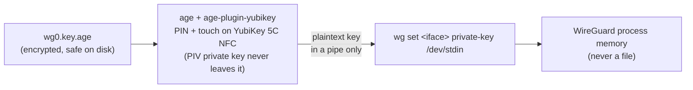
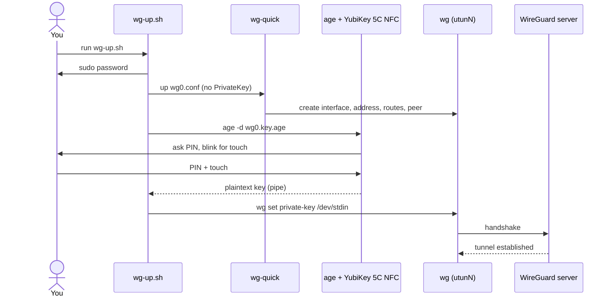

# WireGuard on a MacBook Pro with a YubiKey-protected private key

How to connect a MacBook Pro to a WireGuard server where the client **private key is
stored encrypted** and can only be decrypted with a **YubiKey**. The decrypted key is
piped straight into WireGuard and is **never written to disk**.

## 1. How it works



Connection sequence:



- The key pair that protects the WireGuard key is generated **inside the YubiKey** (PIV
  applet) and cannot be exported.
- `age` encrypts the WireGuard private key to that YubiKey. Decrypting needs the
  YubiKey plugged in, the PIN, and a touch.
- The WireGuard config (`wg0.conf`) contains **no `PrivateKey` line**. The key is injected
  after the tunnel is created, from a pipe.

What is stored locally, and why it's fine:

| File | Secret? | Notes |
|---|---|---|
| `wg0.key.age` | No | Encrypted. Useless without the YubiKey + PIN. |
| `yubikey-identity.txt` | No | A stub that only tells `age` which YubiKey/slot to use. |
| `wg0.conf` | No | No private key inside. Contains the server public key and endpoint. |
| `wg0.pub` | No | Public key you give to the server admin. |

What is **not** avoidable: once the tunnel is up, the key is held in memory by the
WireGuard implementation (wireguard-go). That's inherent to WireGuard.

## 2. Prerequisites

- MacBook Pro running macOS (Apple Silicon or Intel), with [Homebrew](https://brew.sh)
- A **YubiKey 5C NFC**. Its USB-C connector plugs straight into the MacBook Pro, no
  adapter needed. It has the PIV applet this setup uses. The NFC interface isn't used
  here: `age-plugin-yubikey` talks to the key over USB/smart-card, so keep it plugged in
  (NFC is handy for phones, not for this flow).
- Admin access to the WireGuard server (or someone who can add your public key)
- Strongly recommended: a **second YubiKey 5C NFC** as a backup (see section 8)

macOS has built-in smart-card support, so no extra driver is needed.

## 3. Install the tools

```sh
brew install wireguard-tools age age-plugin-yubikey ykman
```

| Package | Purpose |
|---|---|
| `wireguard-tools` | `wg` and `wg-quick` (also installs `wireguard-go`) |
| `age` | Simple file encryption |
| `age-plugin-yubikey` | Lets `age` use a key stored in a YubiKey's PIV slot |
| `ykman` | YubiKey Manager CLI, for PIN setup |

## 4. Prepare the YubiKey

### 4.1 Change the default PIV PIN, PUK and management key

Skip this if you've already set up PIV on this YubiKey. **Defaults are PIN `123456`,
PUK `12345678`.** Change them first:

```sh
ykman piv access change-pin
ykman piv access change-puk
ykman piv access change-management-key --generate --protect
```

> The PIN is 6–8 characters. If you enter a wrong PIN 3 times it's blocked and needs the
> PUK; a wrong PUK 3 times resets PIV entirely. Remember them.

### 4.2 Generate the age identity inside the YubiKey

```sh
age-plugin-yubikey --generate --name wireguard --pin-policy once --touch-policy always
```

- `--pin-policy once`: PIN asked once per YubiKey session (use `always` for a PIN prompt on
  every decryption).
- `--touch-policy always`: physical touch required for **every** decryption. This means
  malware can't silently decrypt your key while the YubiKey is plugged in.

Follow the prompts (PIN and management key). It prints a recipient like:

```
age1yubikey1q2w3e4...
```

Copy that string. It's public.

### 4.3 Save the identity stub

```sh
mkdir -p ~/.config/wireguard && chmod 700 ~/.config/wireguard
cd ~/.config/wireguard
age-plugin-yubikey --identity > yubikey-identity.txt
```

If you have several PIV slots in use, add `--slot N`. List them with
`age-plugin-yubikey --list`.

## 5. Generate and encrypt the WireGuard key

Run this in one pipeline so the plaintext private key only exists in pipes. Replace
`age1yubikey1...` with your recipient:

```sh
cd ~/.config/wireguard
umask 077
wg genkey | tee >(wg pubkey > wg0.pub) | age -r age1yubikey1... -o wg0.key.age
```

Check the result:

```sh
cat wg0.pub                 # public key, send this to the server admin
file wg0.key.age            # should be "age encrypted file"
```

Do **not** use `wg genkey > file`, `echo $KEY`, or paste the key anywhere. Also don't
let it into shell history. The pipeline above avoids that.

Prove that decryption works (it prompts for PIN and touch, and pipes the key into
`wg pubkey`, so only the public key is printed):

```sh
age -d -i yubikey-identity.txt wg0.key.age | wg pubkey
```

The output must equal the contents of `wg0.pub`. This is the safe check: it prints only
the public key.

## 6. Configure the server side

Send `wg0.pub` to the server admin (a public key is safe to send in chat or email). On
the server (Linux example), add a peer:

```ini
# /etc/wireguard/wg0.conf  (server)
[Peer]
# MacBook Pro
PublicKey = <contents of wg0.pub>
AllowedIPs = 10.8.0.2/32
```

Apply it without restarting the tunnel:

```sh
sudo wg set wg0 peer <contents of wg0.pub> allowed-ips 10.8.0.2/32
# and keep it in wg0.conf so it survives a restart
```

You need from the server admin: the **server public key**, the **endpoint**
(`host:51820`), and **your tunnel IP** (`10.8.0.2/32` above).

## 7. Client configuration (no private key)

Create `~/.config/wireguard/wg0.conf`:

```ini
[Interface]
# No PrivateKey here on purpose: it is injected from the YubiKey by wg-up.sh
Address = 10.8.0.2/32
DNS = 10.8.0.1

[Peer]
PublicKey = <server public key>
Endpoint = vpn.example.com:51820
# Full tunnel:
AllowedIPs = 0.0.0.0/0, ::/0
# Or split tunnel (only the VPN network):
# AllowedIPs = 10.8.0.0/24
PersistentKeepalive = 25
```

```sh
chmod 600 ~/.config/wireguard/wg0.conf
```

> The file name sets the interface name (`wg0`). On macOS the real interface is a
> `utunN` device; `wg-quick` records the mapping in `/var/run/wireguard/wg0.name`.

### 7.1 The helper scripts

Create `~/bin/wg-up.sh` (make sure `~/bin` is in your `PATH`, or call it by full path):

```zsh
#!/bin/zsh
# Bring up WireGuard; the private key is decrypted with the YubiKey and piped in.
set -euo pipefail

DIR="$HOME/.config/wireguard"
NAME=wg0
CONF="$DIR/$NAME.conf"

# Authenticate sudo first, so the later pipe doesn't compete with the password prompt.
sudo -v

# 1. Create the interface, address, routes and peer: with no private key yet.
sudo wg-quick up "$CONF"

# 2. Resolve the real utun device name.
IFACE=$(sudo cat "/var/run/wireguard/$NAME.name")

# 3. Decrypt (PIN + touch) and feed straight into WireGuard. Never touches disk.
if ! age -d -i "$DIR/yubikey-identity.txt" "$DIR/$NAME.key.age" \
     | sudo wg set "$IFACE" private-key /dev/stdin; then
  echo "Key injection failed, tearing the tunnel down." >&2
  sudo wg-quick down "$CONF"
  exit 1
fi

sudo wg show "$IFACE"
```

Create `~/bin/wg-down.sh`:

```zsh
#!/bin/zsh
set -euo pipefail
sudo wg-quick down "$HOME/.config/wireguard/wg0.conf"
```

```sh
chmod 700 ~/bin/wg-up.sh ~/bin/wg-down.sh
```

### 7.2 Connect

```sh
wg-up.sh
```

You'll be asked for: your macOS password (sudo), the YubiKey PIN, and then the YubiKey
should blink: **touch it**.

### 7.3 Verify

```sh
sudo wg show
```

Look for a `latest handshake:` line with a recent time and non-zero `transfer:` counters. Then:

```sh
ping 10.8.0.1                 # the server's tunnel IP
curl https://ifconfig.me      # full tunnel: should show the server's public IP
```

If there's no handshake, check section 9.

### 7.4 Disconnect

```sh
wg-down.sh
```

Taking the tunnel down destroys the interface and the key in memory.

## 8. Backup and recovery

The encrypted key is only as recoverable as your YubiKey. A lost or broken single
YubiKey means a lost WireGuard identity (you'd just generate a new key and have the server
admin swap the peer, but plan for it).

**Option A (simple):** keep a second YubiKey as a recipient from the start:

```sh
age-plugin-yubikey --generate --name wireguard-backup ...   # with the 2nd YubiKey plugged in
wg genkey | tee >(wg pubkey > wg0.pub) | age -r age1yubikey1AAA... -r age1yubikey1BBB... -o wg0.key.age
```

Either YubiKey can then decrypt. Store the spare somewhere safe.

**Option B:** don't back up; if the YubiKey is lost, generate a new key pair (section 5)
and ask the server admin to replace your public key. Remove the old peer on the server
immediately.

## 9. Troubleshooting

| Symptom | Cause / fix |
|---|---|
| `age-plugin-yubikey: command not found` inside `age` | Plugin must be in `PATH` of the shell running `age`. Check `which age-plugin-yubikey`. |
| `no YubiKey found` / `No identity matched` | YubiKey not plugged in, or the wrong YubiKey. `age-plugin-yubikey --list`. |
| Hangs waiting after the PIN | The YubiKey is waiting for a **touch**. |
| `wg-quick: ... already exists as utunN` | A stale tunnel. Run `wg-down.sh` or `sudo rm /var/run/wireguard/wg0.name` after confirming it isn't running. |
| `Warning: ... is world accessible` | `chmod 600 ~/.config/wireguard/wg0.conf`. |
| `wg-quick: bash` version error | `brew install bash`. `wireguard-tools` normally pulls it in. |
| Tunnel up but no handshake | Wrong server public key/endpoint, UDP 51820 blocked by a firewall, or the server doesn't have your public key. Check with `wg0.pub` vs the server's `wg show`. Check the key was injected: `sudo wg show` should show `public key:` for the interface. |
| Handshake but no traffic | `AllowedIPs` on the server doesn't include your tunnel IP, or IP forwarding/NAT is missing on the server. |
| PIN blocked | Unblock with the PUK: `ykman piv access unblock-pin`. |
| DNS not working | `DNS =` in `wg0.conf` must be reachable through the tunnel. |

## 10. Security notes

- **Touch policy `always`** is the key protection against a compromised Mac: malware
  can't decrypt without you physically touching the YubiKey.
- Moments the key exists in plaintext: the pipe between `age` and `wg set` (kernel pipe
  buffer) and WireGuard's memory while connected. It never exists as a file. Memory
  could in theory be paged to swap; macOS encrypts swap, and FileVault covers the rest.
- Enable **FileVault**, as it's the real defence for everything else on the laptop.
- Never commit `wg0.key.age` or the identity to a public repo "because it's encrypted".
  It's safe against casual access, but there's no reason to publish it.
- Rotate the WireGuard key occasionally (repeat section 5, update the peer on the server).
- **Auto-start at boot isn't possible** with this setup by design: connecting needs a
  human with the YubiKey (PIN + touch). Use `wg-up.sh` when you need the VPN.

## 11. Quick reference

```sh
# one-time
brew install wireguard-tools age age-plugin-yubikey ykman
age-plugin-yubikey --generate --name wireguard --pin-policy once --touch-policy always
age-plugin-yubikey --identity > ~/.config/wireguard/yubikey-identity.txt
wg genkey | tee >(wg pubkey > wg0.pub) | age -r age1yubikey1... -o wg0.key.age

# every time
wg-up.sh      # PIN + touch
wg-down.sh
```
